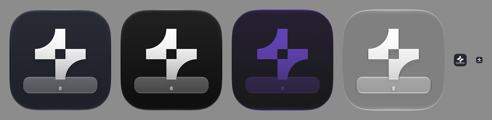

<p align="center"></p>

# NeoDock

A Liquid Glass dock for macOS with widgets next to your apps — and a live view of your **Claude Code** and **Codex** agent sessions.

<!-- Screenshot: docs/screenshot.png -->

## Features

**Dock**
- Liquid Glass bar with your pinned and running apps, magnification under the pointer (Core Animation, display-synced)
- Click, ⌘-click (show in Finder), ⌥-click (hide others), launch bounce, running indicators, badge counts (unread mail …)
- Drag to reorder, drag out to remove, drop an app to pin it, drop files on an app to open them
- Folder stacks on the right (drop a folder to add it, drop files onto it to move them), Trash with full/empty state
- Right-click menus like the system Dock, optional auto-hide, scales down on small screens

**Widgets** (click = quick action, press and hold = card)
- **Agent sessions** — Claude Code and Codex sessions on this Mac: working, waiting for you, ready. Click jumps to the session that needs you.
- Focus timer, Up Next (Calendar), Calculator, Clipboard history, Color picker, Password generator, Note, Volume, Storage, Keep awake, Battery, Clock
- Choose, reorder and size widgets in Settings; widget pages when there are many

## Requirements

- Apple silicon Mac, macOS 26 (Tahoe) or later
- The user interface is currently in German

## Install

Download `NeoDock.zip` from [Releases](../../releases), unzip, move **NeoDock** to Applications and open it.
The release is not notarized: on first launch open **System Settings → Privacy & Security** and click **Open Anyway**.

## Build from source

```bash
git clone https://github.com/neothinkgmbh/NeoDock.git
cd NeoDock
./build.sh --open        # builds, signs and installs ~/Applications/NeoDock.app
swift test               # unit tests
```

`build.sh` signs with your Apple Development certificate. With several certificates in your keychain, put the one to use into a file `.signing-identity` (one line, e.g. `Apple Development: Jane Doe (ABCDE12345)`), so macOS privacy permissions survive rebuilds. Without a certificate it signs ad hoc.

## Permissions

| Permission | Used for |
|---|---|
| Accessibility | badge counts — read from the system Dock (read-only) |
| Automation → Finder | Trash full/empty state and *Empty Trash* |
| Calendars | Up Next widget (asked on first click) |
| Files and folders | folder stacks (asked when a stack is opened) |

Everything stays on your Mac. Agent sessions are read locally and read-only from `~/.claude/sessions`, Claude Code transcripts and `~/.codex/state_5.sqlite`; NeoDock never writes there and sends nothing anywhere.

## Hiding the macOS Dock

*Einstellungen → Allgemein → „macOS-Dock ausblenden, solange NeoDock läuft“* sets a very long auto-hide delay for the system Dock. The original values are saved first and restored when NeoDock quits — also after a crash, via a small watchdog process. Manual reset if ever needed:

```bash
defaults delete com.apple.dock autohide-delay; killall Dock
```

## License

MIT — see [LICENSE](LICENSE).
